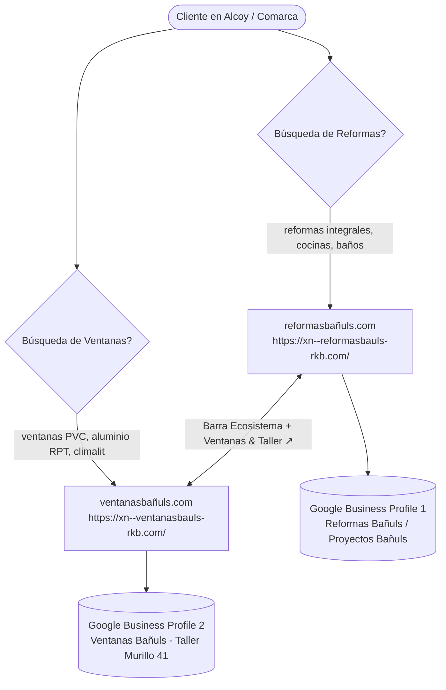

# Estrategia de Posicionamiento SEO, AEO y GEO Multi-Local
## Ecosistema Bañuls: Reformas Bañuls (reformasbañuls.com) & Ventanas Bañuls (ventanasbañuls.com)
**Sede Física y Taller Central:** Carrer Murillo, 41, 03802 Alcoi (Alicante)  
**Contacto Directo:** 601 28 13 13 | Jandrobleal@gmail.com | Instagram: @proyectos.banuls  
**Fecha de Actualización:** Noviembre 2026 | Versión 2.0 Multi-Local

---

## 1. Modelo de Negocio y Arquitectura de Dos Dominios

Para maximizar la cuota de mercado en Google Search, Google Maps (Local 3-Pack) y motores de respuesta AEO (ChatGPT Search, Perplexity, Google AI Overviews), el negocio opera con **dos dominios especializados independientes pero interconectados**:



### A. Dominio A: reformasbañuls.com (`https://xn--reformasbauls-rkb.com/`)
* **Propósito:** Captación de reformas integrales de viviendas, cocinas contemporáneas abiertas, baños con mamparas a medida y rehabilitación en Alcoy y comarca.
* **Ventaja Competitiva Clave:** **Taller propio de carpintería y cerramientos técnicos en Carrer Murillo 41**, lo que permite garantizar presupuesto cerrado sin intermediarios ni demoras en ventanas y mamparas.
* **Ficha Google Business Profile:** `Reformas Bañuls / Proyectos Bañuls`  
  * Enlace canónico de reseñas: [https://share.google/EFxHTu7dtLrR4XIMK](https://share.google/EFxHTu7dtLrR4XIMK)
  * Categorías: *Contratista general*, *Empresa de reformas*, *Diseñador de interiores*.

### B. Dominio B: ventanasbañuls.com (`https://xn--ventanasbauls-rkb.com/`)
* **Propósito:** Fabricación e instalación directa de ventanas de PVC multicámara y aluminio con rotura de puente térmico (RPT), persianas motorizadas, mosquiteras y tramitación de deducción del IRPF (hasta 40%).
* **Partners Oficiales:** **Cortizo**, **Roto Frank** y **Strugal**.
* **Ficha Google Business Profile:** `Ventanas Bañuls`  
  * Place ID: `0xd61865575a2caa7:0xe262f3333a9606ab`
  * Categorías: *Proveedor de ventanas*, *Carpintería de aluminio*, *Instalador de ventanas*.

---

## 2. Estrategia de Interlinking Mutuo y Traspaso de Autoridad (Link Equity)

1. **Barra Superior Ecosistema (`.network-bar`):**
   * Visible en el 100% de las páginas de ambos dominios.
   * Conmutador con texto unificado: `🪟 Ventanas Bañuls | 🔨 Reformas Bañuls`.
   * En móvil se simplifica para evitar cualquier salto de línea.
2. **Navegación Principal:**
   * En `reformasbañuls.com`: enlace directo destacado `🪟 Ventanas & Taller ↗` (`target="_blank"` y `rel="noopener"`) hacia `ventanasbañuls.com`.
3. **Pie de Página Corporativo:**
   * Enlace contextual *"¿Buscas carpintería de ventanas y cerramientos? Visita nuestro taller oficial ventanasbañuls.com"*.
4. **Formulario de Contacto (Captación Cruzada):**
   * Checkbox en `ventanasbañuls.com`: *"¿Tu proyecto incluye también reforma de baño, cocina o vivienda completa? (Te asesorará conjuntamente nuestro estudio Reformas Bañuls)"*.

---

## 3. Desglose Multi-Local: Municipios Medianos vs. Pueblos Pequeños (El Comtat)

Para evitar la canibalización de keywords y el riesgo de "thin content" (páginas con contenido escaso penalizadas por Google Helpful Content System), se implementa una estructura en tres niveles:

### Nivel 1: Sede Central (Alcoy)
* **URL:** `https://xn--reformasbauls-rkb.com/`
* **Subpáginas temáticas:** `reformas-integrales-alcoy.html`, `reforma-banos-alcoy.html`, `reforma-cocinas-alcoy.html`.
* **Enfoque:** Ensanche, Santa Rosa, Centro Histórico, Zona Norte, Batoi.

### Nivel 2: Landings Geo-Satélite para Municipios Medianos (Estructura Canónica de 11 Secciones)
Cada landing dispone de contenido 100% original con citación explícita de problemas constructivos locales, distancias reales al taller y trámites ante el ayuntamiento local:

1. **`reformas-cocentaina.html` (Cocentaina y pedanías):**
   * *Palabras clave objetivo:* "reformas cocentaina", "reformas integrales cocentaina", "reforma baños cocentaina".
   * *Particularidad local:* Casas de pueblo en El Raval, Fraga y Vila con muros de piedra y humedades por capilaridad; chalets en Gormaig y la huerta.
   * *Licencias:* Tramitación ante el **Ayuntamiento de Cocentaina** (Plaça del Pla, 1).
   * *Distancia:* A solo 5 minutos del taller en Murillo 41. 0€ de recargo.

2. **`reformas-muro-de-alcoy.html` (Muro de Alcoy):**
   * *Palabras clave objetivo:* "reformas muro de alcoy", "cerramientos de porches muro", "reforma cocinas muro".
   * *Particularidad local:* Chalets residenciales, parcelas, porches abiertos expuestos al viento y cocinas cerradas que se abren a terrazas.
   * *Licencias:* Tramitación ante el **Ayuntamiento de Muro de Alcoy** (Plaça del Matzem, 1).
   * *Distancia:* A 10 minutos por la A-7.

3. **`reformas-ibi.html` (Ibi - 23.000+ hab.):**
   * *Palabras clave objetivo:* "reformas ibi", "reformas integrales ibi", "aislamiento termico ibi".
   * *Particularidad local:* Clima severo de la Foia de Castalla (más de 800 m de altitud), frío invernal extremo, condensaciones en paredes y pisos de los años 70-80 que precisan renovación de fontanería.
   * *Licencias:* Tramitación ante el **Ayuntamiento de Ibi** (Carrer les Eres, 48).
   * *Distancia:* A 15 minutos directos por autovía.

4. **`reformas-onil.html` (Onil - 7.500 hab.):**
   * *Palabras clave objetivo:* "reformas onil", "rehabilitacion casas de pueblo onil", "reformas de baños onil".
   * *Particularidad local:* Casas tradicionales con vigas de madera y cubiertas que exigen oficio artesanal; chalets en partidas rurales sin recargo por kilometraje.
   * *Licencias:* Tramitación ante el **Ayuntamiento de Onil** (Plaça Major, 1).
   * *Distancia:* A 18 minutos de la sede.

### Nivel 3: Hub Comarcal para Pueblos Pequeños de El Comtat (`reformas-el-comtat.html`)
Para pueblos con baja densidad poblacional donde crear páginas individuales generaría contenido duplicado (Benimarfull, Planes, Benilloba, Gaianes, Beniarrés, Gorga, Agres, Alcocer, Millena):
* **URL:** `https://xn--reformasbauls-rkb.com/reformas-el-comtat.html`
* **Especialización técnica:** Rehabilitación de casas de pueblo rústicas, masías, techos y cubiertas, saneamiento de humedades en muros de carga y adecuación de segundas residencias.
* **Propuesta diferencial:** Reporte semanal por WhatsApp con fotos y vídeos para propietarios que residen en Alicante o Valencia.

---

## 4. Estructura de las 11 Secciones Canónicas (Skill SEO/AEO)

Cada landing geo-satélite aplica con rigidez la arquitectura de conversión probada:

1. **Hero + Bloque AEO Directo (45-60 palabras):** Titular H1 geo-específico, respuesta directa para IA Overviews, teléfono directo (`601 28 13 13`) y WhatsApp preconfigurado.
2. **Problema Local:** 3 retos arquitectónicos reales de la zona.
3. **Solución Bañuls con Taller Propio:** Ventaja de fabricar sin intermediarios en Carrer Murillo 41.
4. **Tabla Comparativa:** Bañuls (Taller propio, presupuesto cerrado, 60 años) vs. Subcontratas informales.
5. **Reseñas Verificadas Google Business:** Testimonios locales de 5 estrellas con enlace oficial a la ficha.
6. **CTA Intermedio Destacado:** Oferta de visita y medición técnica gratuita en menos de 48 horas.
7. **Proceso en 4 Pasos:** Visita in situ -> Proyecto 3D -> Fabricación y obra -> Entrega limpia llave en mano.
8. **Slider Antes / Después Interactivo:** Deslizable táctil de transformación real.
9. **FAQ Local (6 preguntas):** Respuestas concisas con precios aproximados (€/m²), plazos y licencias municipales.
10. **4 Garantías Escritas:** Presupuesto cerrado, compromiso de fecha, seguro de 300.000€ y taller cercano.
11. **CTA Final, Formulario y Mapa Google:** Formulario con selector de servicio y ubicación exacta en Carrer Murillo 41.

---

## 5. Implementación Técnica de Marcado Estructurado (Schema JSON-LD)

En todo el sitio web se inyecta en `areaServed` el array completo para indicar cobertura territorial sin penalización:

```json
{
  "@context": "https://schema.org",
  "@type": ["GeneralContractor", "HomeAndConstructionBusiness", "LocalBusiness"],
  "name": "Reformas Bañuls",
  "url": "https://xn--reformasbauls-rkb.com/",
  "telephone": "+34601281313",
  "email": "Jandrobleal@gmail.com",
  "address": {
    "@type": "PostalAddress",
    "streetAddress": "Carrer Murillo, 41",
    "addressLocality": "Alcoi",
    "postalCode": "03802",
    "addressRegion": "Alicante",
    "addressCountry": "ES"
  },
  "areaServed": [
    {"@type": "City", "name": "Alcoy"},
    {"@type": "City", "name": "Cocentaina"},
    {"@type": "City", "name": "Muro de Alcoy"},
    {"@type": "City", "name": "Ibi"},
    {"@type": "City", "name": "Onil"},
    {"@type": "City", "name": "Castalla"},
    {"@type": "City", "name": "Banyeres de Mariola"},
    {"@type": "City", "name": "Benimarfull"},
    {"@type": "City", "name": "Planes"},
    {"@type": "City", "name": "Benilloba"}
  ],
  "sameAs": [
    "https://share.google/EFxHTu7dtLrR4XIMK",
    "https://www.instagram.com/proyectos.banuls/"
  ]
}
```

---

## 6. Cumplimiento Legal y Analítica (GDPR / Google Analytics 4)

* **Google Analytics 4:** ID configurable vía `GA_MEASUREMENT_ID` en `js/analytics.js`.
* **Google Consent Mode v2:** Cookies bloqueadas por defecto (`analytics_storage: denied`) hasta el consentimiento expreso del usuario en el banner flotante.
* **Seguimiento Automático de Conversiones:**
  * Clics en botón WhatsApp (`generate_lead`).
  * Clics en llamada telefónica (`contact`).
  * Envíos de formulario de presupuesto (`generate_lead`).
* **Textos Legales:** `aviso-legal.html`, `politica-privacidad.html` y `politica-cookies.html` enlazados en todos los footers.
